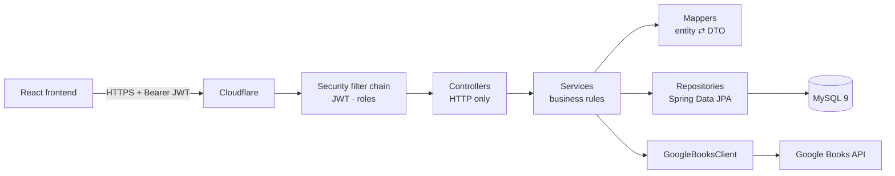

# ByteBooks API

REST API behind **ByteBooks**, a community book catalog: readers browse books by category, write reviews, keep a list of favorites and maintain a public profile, while moderators curate the catalog and admins import new titles from Google Books.

**Live demo:** [bytebooks.lautaromoreyra.dev](https://bytebooks.lautaromoreyra.dev) · Frontend: [bytebooks-frontend](https://github.com/lautaromoreyraa/bytebooks-frontend)


## Features

- **Catalog** — books with many-to-many categories; hidden books are invisible to anyone who can't manage them, including through favorites and public profiles.
- **Google Books import** — search Google Books, preview the candidates and confirm which ones to import. Duplicates are rejected by ISBN and by title before anything is written.
- **Reviews** — one review per user and book, paginated newest first, with an average rating summary.
- **Favorites and public profiles** — each user curates a list of saved books that others can browse.
- **Accounts and roles** — registration, JWT login and logout (revoked tokens are rejected until they expire), and `USER` / `MODERATOR` / `ADMIN` permissions.

## Tech stack

| Layer | Choice |
|---|---|
| Language / framework | Java 21, Spring Boot 3.5 (Web, Data JPA, Security, Validation, Actuator) |
| Database | MySQL 9, schema owned by Flyway |
| Auth | Stateless JWT, BCrypt password hashing |
| External API | Google Books (server-side client) |
| Images | Cloudinary, uploaded by the browser with a signature issued by the API |
| Tests | JUnit 5, MockMvc, Testcontainers (real MySQL 9) |
| Runtime | Multi-stage Docker image, non-root user, layered Spring Boot jar |
| Hosting | Railway (API + MySQL) behind Cloudflare |

## Architecture

A classic layered Spring application: controllers only speak HTTP, services hold the business rules, repositories persist, and hand-written mappers translate between JPA entities and DTOs so entities never leave the service layer.



**Request flow, e.g. importing a book:** the admin's request passes the JWT filter and role check → `ImportacionDeLibrosController` → `ImportacionDeLibrosService` queries Google Books through `GoogleBooksClient`, drops candidates whose ISBN or title already exist, maps the rest to `Libro` entities → `LibroRepository` saves them in one transaction → the response DTO reports what was imported and what was skipped.

Design decisions worth noting:

- **Flyway is the only owner of the schema** (`ddl-auto=none`); a rename can never silently drop data.
- **`open-in-view` is disabled**, so lazy associations are fetched explicitly in the repository (fetch joins and entity graphs), with no N+1 queries hidden in the view layer.
- **No configuration value is hard-coded**: everything is read from environment variables, and secrets have no defaults, so the app refuses to start without them.

## Project structure

```
src/main/java/com/bytebooks/api
├── client/        Google Books HTTP client
├── controller/    REST endpoints — HTTP in, DTO out, no business logic
├── domain/        JPA entities (Libro, Categoria, Resena, Usuario)
├── dto/<area>/    request and response records, grouped by feature
├── enumeration/   domain enums (roles, book status)
├── exception/     custom exceptions and the global error handler
├── mapper/<area>/ mapper interface + hand-written implementation
├── repository/    Spring Data interfaces, no logic
├── security/      filter chain, JWT, token revocation, rate limiting
└── service/<area>/ business logic per feature, interface + implementation
src/main/resources/db/migration   Flyway migrations
src/test/java/...                  mirrors main, plus fixture/ test data builders
```

Class names are in Spanish (`Libro`, `ImportacionDeLibrosService`, `FiltroDeAutenticacionJwt`, `ManejadorGlobalDeErrores`) because it is the language of the business; technical suffixes stay in English (`Controller`, `Service`, `Repository`, `Mapper`, `Dto`). Names of external APIs keep their own (`GoogleBooksClient`).

## API overview

| Method | Path | Access |
|---|---|---|
| `POST` | `/auth/register`, `/auth/login`, `/auth/logout` | public / authenticated |
| `GET` | `/libros`, `/libros/{id}` | public |
| `POST` | `/libros` | admin |
| `PUT` `DELETE` | `/libros/{id}` | moderator / admin |
| `GET` | `/categorias`, `/categorias/{id}` | public |
| `POST` `PUT` `DELETE` | `/categorias/**` | admin |
| `GET` | `/libros/{id}/resenas`, `/libros/{id}/resenas/resumen` | public |
| `POST` | `/libros/{id}/resenas` | authenticated |
| `PUT` `DELETE` | `/resenas/{id}` | author / moderator / admin |
| `GET` | `/usuarios/{id}`, `/usuarios/{id}/favoritos` | public |
| `GET` `POST` `DELETE` `PUT` | `/usuarios/me/favoritos/**`, `/usuarios/me/perfil` | authenticated |
| `GET` `POST` | `/admin/libros/import/**` | admin |
| `POST` | `/imagenes/firma` | authenticated — signs a direct upload to Cloudinary |
| `GET` | `/actuator/health` | platform health probe |

## Getting started

**Prerequisites:** Java 21 and Docker (or Podman with the Docker CLI). Maven comes with the wrapper.

```bash
# 1. Database credentials for the local MySQL container
cat > .env <<'EOF'
MYSQL_ROOT_PASSWORD=change-me
MYSQL_DATABASE=bytebooks
EOF

# 2. Run the API — spring-boot-docker-compose starts MySQL from compose.yaml
export JWT_SECRET=$(openssl rand -base64 48)
export GOOGLE_BOOKS_API_KEY=your-key
./mvnw spring-boot:run
```

The API listens on `http://localhost:8080`. Configuration is read from environment variables:

| Variable | Purpose |
|---|---|
| `MYSQLHOST`, `MYSQLPORT`, `MYSQLDATABASE`, `DB_USERNAME`, `DB_PASSWORD` | Database connection (resolved from Docker Compose locally) |
| `JWT_SECRET` | Token signing key — required, no default |
| `GOOGLE_BOOKS_API_KEY` | Google Books API key |
| `JWT_EXPIRATION_MS` | Token lifetime (default 30 minutes) |
| `CLOUDINARY_CLOUD_NAME`, `CLOUDINARY_API_KEY`, `CLOUDINARY_API_SECRET` | Signing image uploads; without them only `/imagenes/firma` answers `503` |

### Tests

```bash
./mvnw test
```

Integration tests run against a real MySQL 9 started by Testcontainers, so the Flyway migrations, queries and security rules are exercised exactly as in production.

## Deployment

The `Dockerfile` builds in two stages (Maven build → JRE-only runtime), splits the jar into Spring Boot layers so code-only changes ship small images, and runs as an unprivileged user with an explicit JVM memory ceiling. Railway builds it on every push to `main` and only promotes a deployment once `/actuator/health` reports `UP`. Service settings live in `.railway/railway.ts` and are applied with `railway config apply`.
